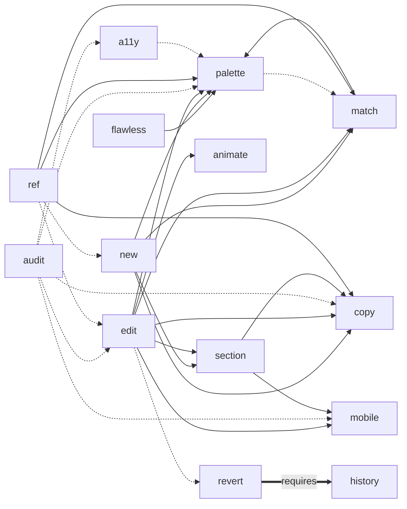

# Command graph

Generated from `manifest.json`. Solid arrows are calls (one command runs another). Dashed arrows are hand-offs (control passes after the user decides). `requires` means the other command's data must exist.

## Calls (text form)

- `/flawless` calls `/palette`; hands off to none.
- `/flawless-c` calls none; hands off to none.
- `/new` calls `/palette`, `/copy`, `/section`, `/match`; hands off to none.
- `/edit` calls `/palette`, `/copy`, `/section`, `/mobile`, `/animate`, `/match`; hands off to `/revert`.
- `/audit` calls none; hands off to `/palette`, `/copy`, `/edit`, `/mobile`, `/a11y`.
- `/palette` calls none; hands off to `/match`.
- `/copy` calls none; hands off to none.
- `/section` calls `/copy`, `/mobile`; hands off to none.
- `/match` calls `/palette`; hands off to none.
- `/animate` calls none; hands off to none.
- `/mobile` calls none; hands off to none.
- `/ref` calls `/palette`, `/copy`, `/match`; hands off to `/new`, `/edit`.
- `/a11y` calls none; hands off to `/palette`.
- `/history` calls none; hands off to none.
- `/revert` calls none; hands off to none.

## Shared layers

- **Rules:** `core/rules.md` and thresholds in `core/tokens/rules.json`. Read by every command that builds or checks UI.
- **Hooks:** `core/hooks.md`. Snapshot before changes; audit, state, and report after.
- **State:** `core/state.md`, managed by `core/scripts/state.py`. One session scheme shared by all commands.
- **Scripts:** `core/scripts/` (audit, palette, snapshot, state, extract_palette, analyze_layout, build, validate).
