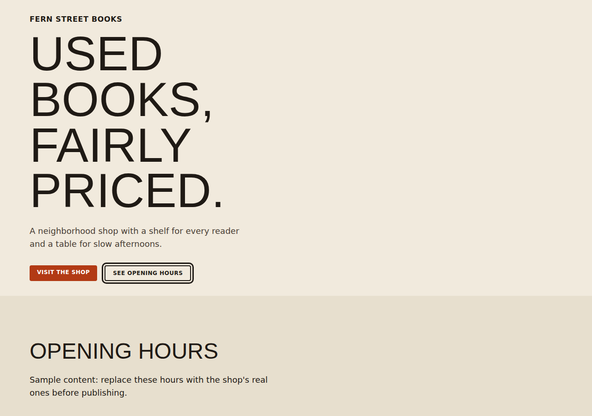
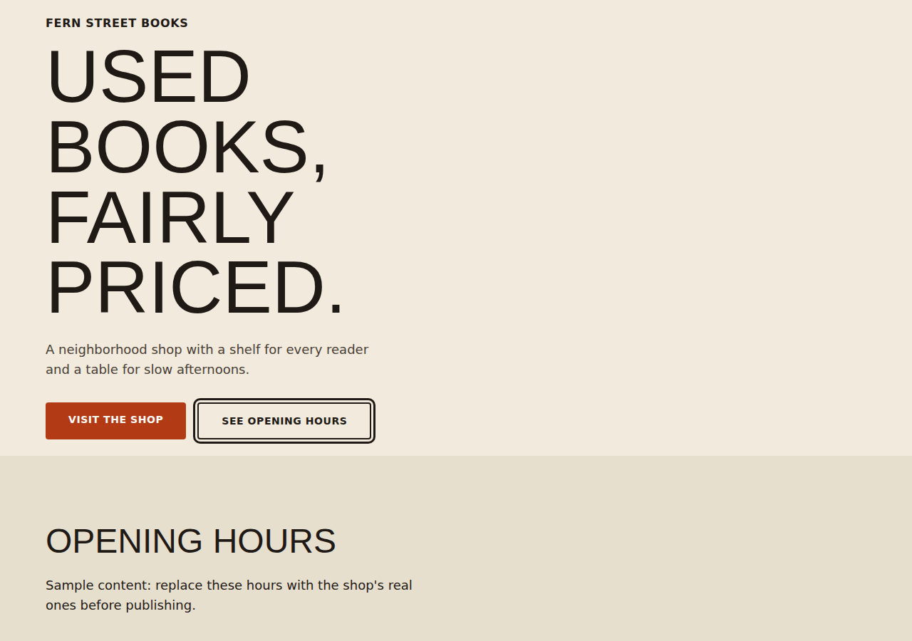

# Examples

Every page here is a single self-contained HTML file. The copy is sample content (a made-up bookshop), not real business information.

| Page | What it shows | Audit |
| --- | --- | --- |
| [`landing.html`](./landing.html) | A complete landing page built to the rules | clean |
| [`audit-before.html`](./audit-before.html) | A page full of the problems `/audit` finds | 13 errors |
| [`audit-after.html`](./audit-after.html) | The same page after the fixes | clean |
| [`a11y-before.html`](./a11y-before.html) | Missing language, alt text, focus style, weak contrast | 4 errors |
| [`a11y-after.html`](./a11y-after.html) | Accessibility fixed | clean |
| [`mobile-before.html`](./mobile-before.html) | No viewport tag, no phone layout, small tap targets | 2 errors |
| [`mobile-after.html`](./mobile-after.html) | Phone layout fixed | clean |

Run any of them:

```text
python core/scripts/audit.py examples/audit-before.html --a11y --mobile --explain
```

CI audits every "after" page and expects every "before" page to fail, so these examples cannot drift from the rules.

## Transcripts

Real script output is in [`transcripts/`](./transcripts): [audit](./transcripts/audit.md), [audit with explanations](./transcripts/audit-explain.md), [after the fixes and strictness modes](./transcripts/audit-after.md), [browser check](./transcripts/browser-check.md). [`edit-preview.md`](./transcripts/edit-preview.md) is an illustrative conversation.

## Screenshots

Captured with `core/scripts/browser_check.py --shots`. Phone is 375 px wide, desktop is cropped to the first 900 px.

| | Phone | Desktop |
| --- | --- | --- |
| Landing page |  |  |
| Audit before |  |  |
| Mobile before |  |  |
| Mobile after |  |  |

To publish these as a live demo, enable GitHub Pages for the `examples/` folder (Settings, Pages, deploy from a branch, `/examples`).
